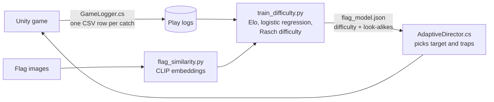
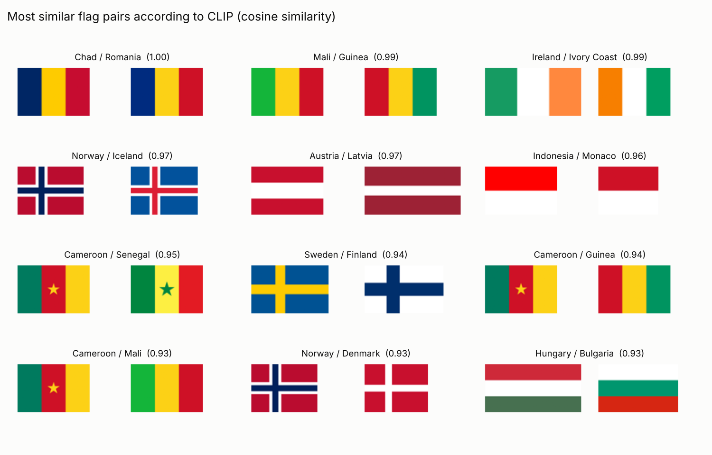
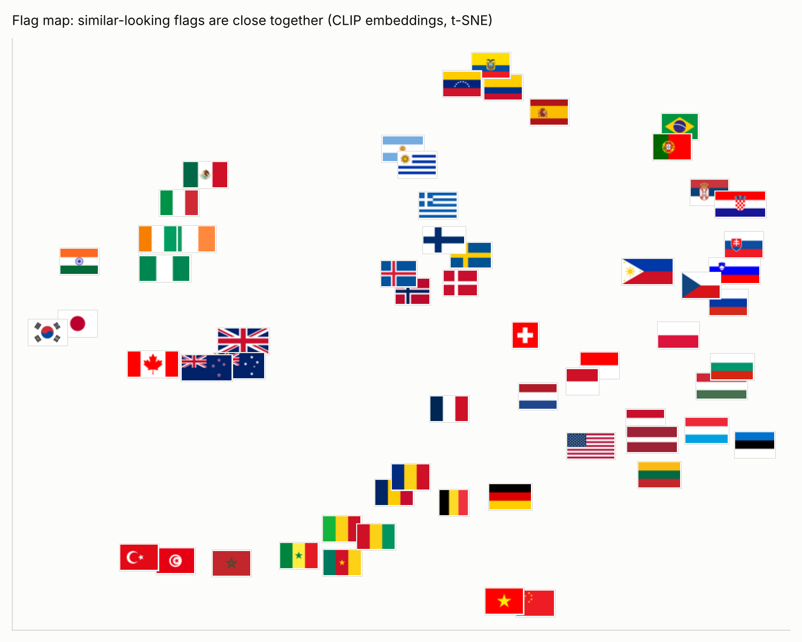
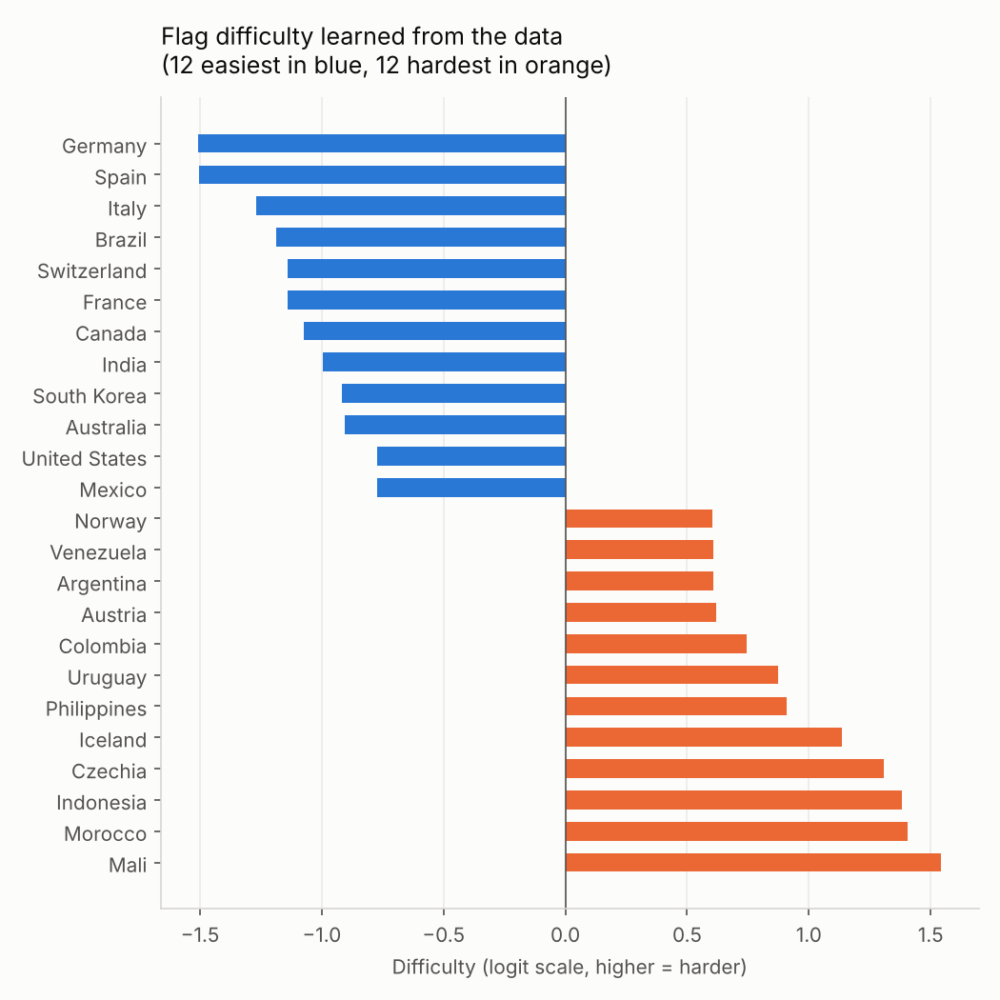
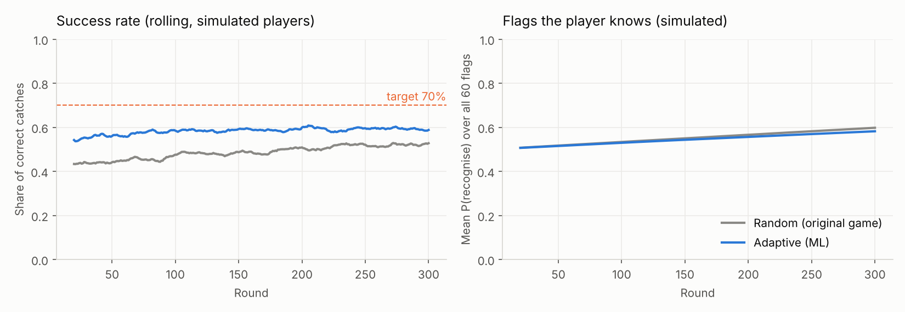

# FlagFall — a flag game that adapts to the player, with computer vision and machine learning

FlagFall is a 2D Unity game: flags fall from the sky, a country name is shown at the top
of the screen, and you move a basket with the arrow keys to catch the right flag. A wrong
flag costs a life.

I built the game for a course at the University of Geneva, then extended it with machine
learning:

- **Computer vision (CLIP)** finds which flags look alike (Chad and Romania, Ireland and
  Ivory Coast...), so harder levels drop look-alike flags as traps.
- **An adaptive difficulty system** estimates the player's level and each flag's difficulty
  in real time (an Elo-style rating model), and picks the country to find so that the
  player succeeds about 70% of the time.
- **A data pipeline**: the game logs every catch to CSV; a Python pipeline trains and
  evaluates models on these logs and exports the result back to the game as JSON.

> Add a GIF of the game here: `docs/gameplay.gif`

## How it works



## 1. Which flags look alike? (CLIP)

Each of the 60 flags is encoded by the image encoder of
[CLIP](https://huggingface.co/openai/clip-vit-base-patch32), a pre-trained vision model.
Flags that look alike get similar vectors, and the cosine similarity between two vectors
measures how easy they are to confuse. No training is needed: the pre-trained model is
used as a feature extractor.



The map below places each flag in 2-D (t-SNE of the CLIP vectors). Nordic crosses, Slavic
tricolours, West-African tricolours and red-and-white bicolours form clear groups.



In the game, each country gets its 4 most similar flags. When the player is doing well,
wrong flags are more often chosen among these look-alikes.

## 2. Adaptive difficulty

### In the game: an online rating model

`AdaptiveDirector.cs` keeps a skill rating θ for the player, a difficulty rating b for
each flag and a personal adjustment u for each (player, flag) pair:

```
P(catch the right flag) = sigmoid(θ − b + u)
```

After each catch, the three values are updated in the direction of the error (like an Elo
rating in chess). Then:

- **Target country**: the flag whose predicted success is closest to 70%, drawn at
  random with a softmax so the game stays varied. Flags the player just missed come back
  a few rounds later.
- **Traps**: the chance that a wrong flag is a look-alike of the target grows when the
  player's recent success rate is above 70%, and shrinks when it is below.

Ratings are saved between games (per player name), so the game keeps adapting over time.

### Offline: learning from the logs

`ml/train_difficulty.py` replays the logs in chronological order and compares three ways
of predicting whether the player catches the right flag, on the last 30% of events:

| Model | Inputs |
| --- | --- |
| Baseline | the average success rate |
| Elo (in-game model) | the online rating model above |
| Logistic regression | Elo prediction + the player's history with this flag + how similar the other flags on screen were (CLIP) |

All features are computed only from past events, as the game would see them (no data
leakage). It then fits the final flag difficulties with a Rasch model (a logistic
regression with one coefficient per player and per flag) and exports them, with the
look-alike lists, to `Assets/StreamingAssets/flag_model.json`.

## Results

> **Important: these results come from simulated players**, not from real people yet.
> `ml/simulate_players.py` generates players following a simple model I chose (known
> flags are easier, look-alikes cause mistakes, players learn mostly from correct
> catches). They show that the pipeline works end to end; real playtests are the next step.

**Prediction** (simulated playtest: 25 players, 200 games, 1,274 catches):

| Model | Log-loss ↓ | AUC ↑ |
| --- | --- | --- |
| Baseline | 0.694 | 0.50 |
| Elo (in-game model) | 0.664 | 0.64 |
| Logistic regression | **0.644** | **0.70** |

The logistic regression gives a strong negative weight to the similarity of the flags on
screen: as expected, a look-alike on screen makes mistakes more likely.



**Adaptive vs original game** (200 simulated players, 300 rounds each, same players in
both versions):

| Game | Success rate | Flags known after 300 rounds |
| --- | --- | --- |
| Original (random) | 48.6% | 59.8% |
| Adaptive | **58.2%** | 58.2% |



The adaptive game keeps players in a more comfortable zone (fewer lost lives), but it does
not reach the 70% target and does not make players learn faster in this simulation. Two
likely reasons: picking the flags that *look* like 70% favours flags whose difficulty is
overestimated by noisy early ratings, and the look-alike traps lower the success rate.
Real playtests will tell whether the same happens with real players.

**A bug the data revealed.** In a first version, the log did not record a wrong flag that
the player had caught among the "flags on screen". The model then learned that look-alikes
on screen made success *more* likely, the opposite of reality. Logging all wrong flags on
screen fixed it (coefficient from +2.2 to −2.2) and improved the AUC from 0.65 to 0.70.

## Run it

**Game** (Unity 6, version 6000.4):

1. Open the project in Unity Hub.
2. Menu **FlagFall > Setup flags and country list**: sets up the 60 flags and fills the
   country list of the `GameManager`. Save the scene.
3. Play. The `GameManager` adds the `AdaptiveDirector` and `GameLogger` components
   automatically. To play the original random game, add `AdaptiveDirector` to the
   `GameManager` yourself and uncheck `Use Adaptive`.

**ML pipeline** (Python 3.10+):

```bash
pip install -r ml/requirements.txt
python ml/download_flags.py        # flag images (already in the repo)
python ml/flag_similarity.py       # CLIP similarities + figures
python ml/simulate_players.py      # simulated logs + adaptive vs random
python ml/train_difficulty.py --simulated
```

**With real players**: play the game, use **FlagFall > Copy logs into the project**, then
run `python ml/train_difficulty.py`. It retrains on `ml/data/logs/` and updates
`flag_model.json` for the game.

## Project structure

```
Assets/
  Scripts/
    GameManager.cs, FlagSpawner.cs, Flag.cs, PlayerController.cs   game (course project)
    AdaptiveDirector.cs   online rating model, picks target and traps
    GameLogger.cs         asks the player name, logs every event to CSV
    FlagModel.cs          reads flag_model.json
  Editor/FlagFallTools.cs  Unity menu: set up flags, open and copy logs
  StreamingAssets/flag_model.json   model exported by the Python pipeline
  Flags/                   60 flag images
ml/
  flag_similarity.py       CLIP embeddings and similarity
  simulate_players.py      simulated players, adaptive vs random
  train_difficulty.py      model comparison, flag difficulty, export to Unity
  policy.py                Python twin of AdaptiveDirector.cs
docs/figures/              charts used in this README
```

## Limitations and next steps

- Run a real playtest (around 20 players) and replace the simulated results.
- Show the right flag after a mistake, so that players learn from errors too.
- Tune the target success rate per player, and test whether 60% or 70% keeps players
  playing longer.
- Use the confusions observed in real games to refine the look-alike lists (already
  supported by `train_difficulty.py`).

## Credits

- Flag images: [flagcdn.com](https://flagcdn.com) (public domain flags).
- CLIP: OpenAI, via Hugging Face Transformers.
- Game made for a course at the University of Geneva.
